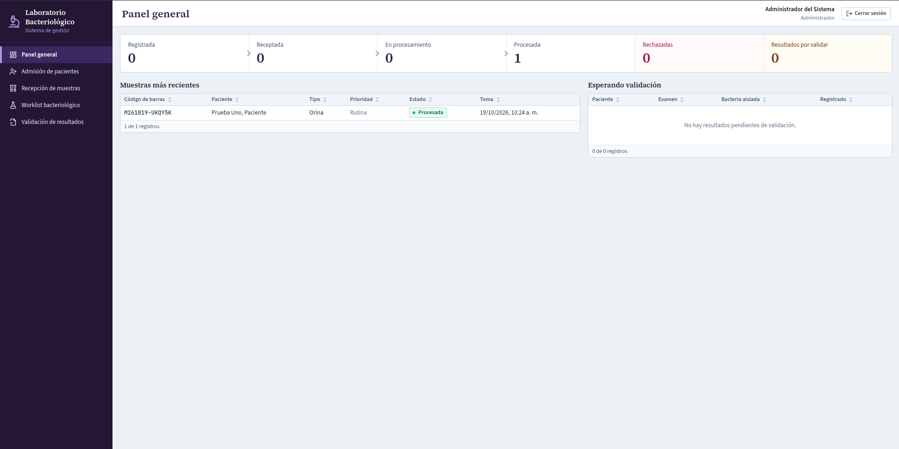
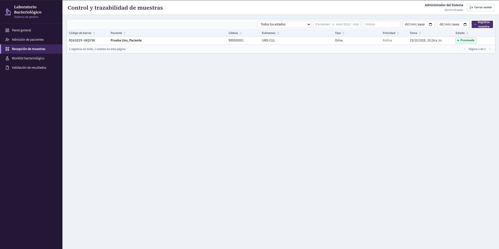
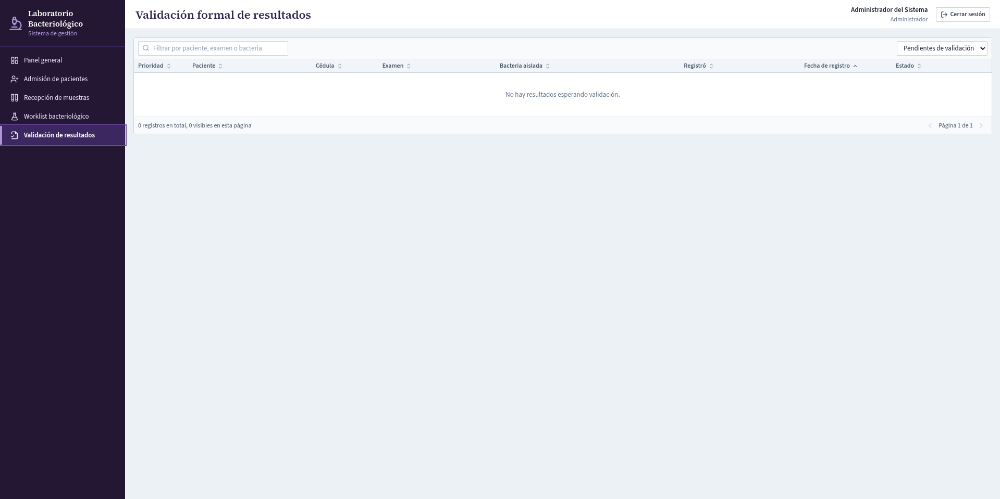

# Sistema Web para la Gestión de un Laboratorio Bacteriológico

**Proyecto universitario de Base de Datos I · En desarrollo**

## ¿De qué trata el proyecto?

Este proyecto lo estamos desarrollando como parte de nuestro trabajo universitario. Queremos crear una aplicación web que ayude a organizar algunos de los procesos que se realizan en un laboratorio bacteriológico, como el registro de pacientes, las solicitudes de exámenes, el manejo de muestras y los resultados.

También nos ha servido para poner en práctica lo que hemos aprendido sobre bases de datos y conocer un poco más sobre el desarrollo de aplicaciones web, tanto en el frontend como en el backend.

## ¿Qué hemos logrado hasta ahora?

Por ahora tenemos implementadas varias de las funciones principales:

- Registrar y consultar pacientes.
- Crear solicitudes de exámenes.
- Registrar, recibir y hacer seguimiento a las muestras.
- Guardar hallazgos y resultados de los análisis.
- Revisar y validar resultados según el rol del usuario.
- Consultar el historial de algunas acciones realizadas en el sistema.

También contamos con cuatro roles: **administrador, recepcionista, bacteriólogo y validador**. Cada uno tiene permisos diferentes dependiendo de las tareas que realiza.

Hemos probado el recorrido principal del sistema con datos ficticios, desde el registro de un paciente hasta la validación de un resultado. Aun así, todavía hay funciones que queremos revisar con más detalle.

## Tecnologías que utilizamos

| Parte | Tecnologías |
| --- | --- |
| Frontend | React, TypeScript, Vite y Tailwind CSS |
| Backend | Node.js, Express y TypeScript |
| Base de datos | MySQL y Prisma |
| Otras herramientas | Git, GitHub, Docker y Vitest |

## Capturas del sistema

Estas son algunas de las pantallas que tenemos implementadas hasta el momento.

### Panel principal



### Gestión de muestras



### Resultados del laboratorio



**Nota:** La interfaz que se muestra actualmente es solo una primera base que utilizamos para desarrollar y probar las funcionalidades del sistema. Tenemos pensado hacer un rediseño más adelante para mejorar su apariencia, la organización de las pantallas y la facilidad de uso.

## ¿Qué queremos seguir implementando y mejorando?

Aunque ya tenemos una primera versión funcional, todavía tenemos varias ideas para continuar con el proyecto.

**Funciones que queremos agregar o completar:**

- Seguir trabajando en el módulo de antibiogramas y probar mejor su funcionamiento.
- Ampliar las opciones para gestionar los exámenes y análisis del laboratorio.
- Agregar la posibilidad de generar y descargar reportes de resultados.
- Mejorar las búsquedas y los filtros de pacientes, solicitudes y muestras.

**Cosas que queremos mejorar:**

- Rediseñar la interfaz para que tenga una apariencia más agradable y una navegación más sencilla.
- Organizar mejor algunas pantallas y formularios.
- Mejorar los mensajes de error y las validaciones.
- Corregir los problemas que vayamos encontrando durante las pruebas.
- Ampliar las pruebas y revisar algunos aspectos de seguridad.

Estas son las ideas que tenemos por ahora. Seguramente iremos ajustando algunas cosas a medida que avancemos y aprendamos más durante el desarrollo.

## ¿Cómo ejecutar el proyecto?

Para probarlo en tu computador necesitas **Node.js 20 o superior**, npm y **MySQL 8**. Nosotros hemos utilizado MySQL 8.4 con Docker.

**1. Descargar el proyecto**

```bash
git clone https://github.com/KiyotakaAll/sistema-gestion-laboratorio-bacteriologico.git
cd sistema-gestion-laboratorio-bacteriologico
```

**2. Preparar la base de datos**

Crea una base de datos de pruebas en MySQL y carga el archivo `database/schema.sql`. **No lo ejecutes sobre una base de datos con información importante**, porque puede eliminar tablas existentes.

**3. Iniciar el backend**

```bash
cd backend
npm ci
cp .env.example .env
```

Edita `backend/.env` para configurar la conexión a MySQL y tu propia clave JWT. Después ejecuta:

```bash
npm run prisma:generate
npm run seed
npm run dev
```

El backend se ejecuta en `http://localhost:3000`.

**4. Iniciar el frontend**

Abre otra terminal desde la carpeta principal del proyecto:

```bash
cd frontend
npm ci
npm run dev
```

Entra a `http://localhost:5173`. Las cuentas de prueba se crean con el comando `npm run seed` y están definidas en `backend/prisma/seed.ts`.

## Integrantes

Este proyecto lo estamos desarrollando como parte de nuestro trabajo universitario:

- [KiyotakaAll](https://github.com/KiyotakaAll)
- [Katojienta01](https://github.com/Katojienta01)

---

**Nota:** Este sistema es un proyecto académico en desarrollo. No está preparado para utilizarse con información clínica real; las pruebas se han realizado con datos ficticios.
